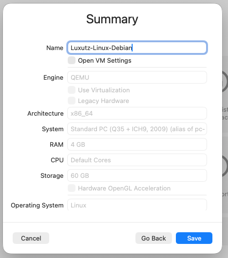
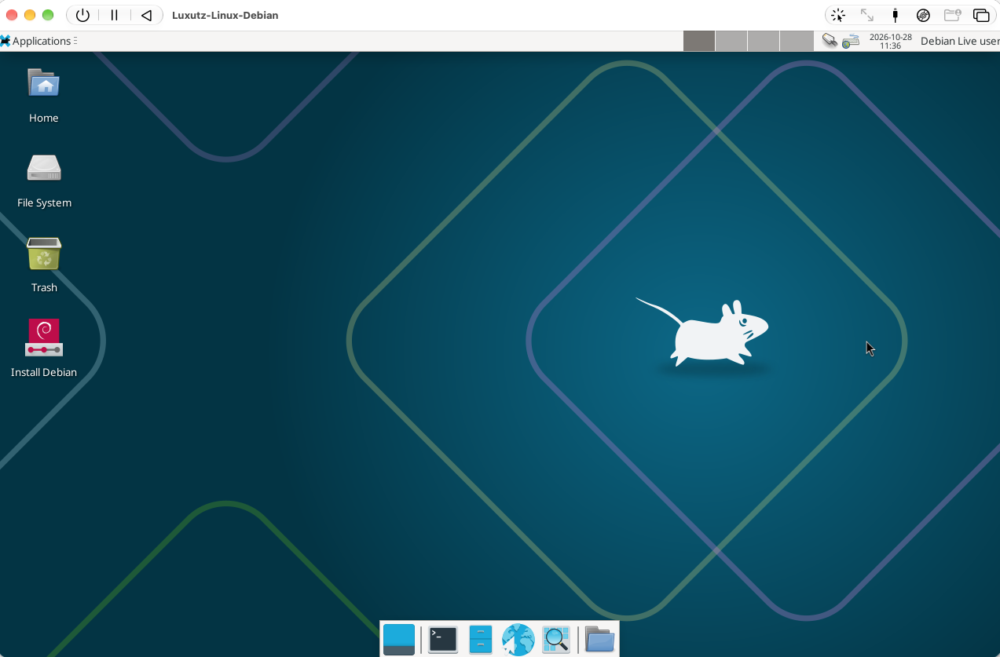
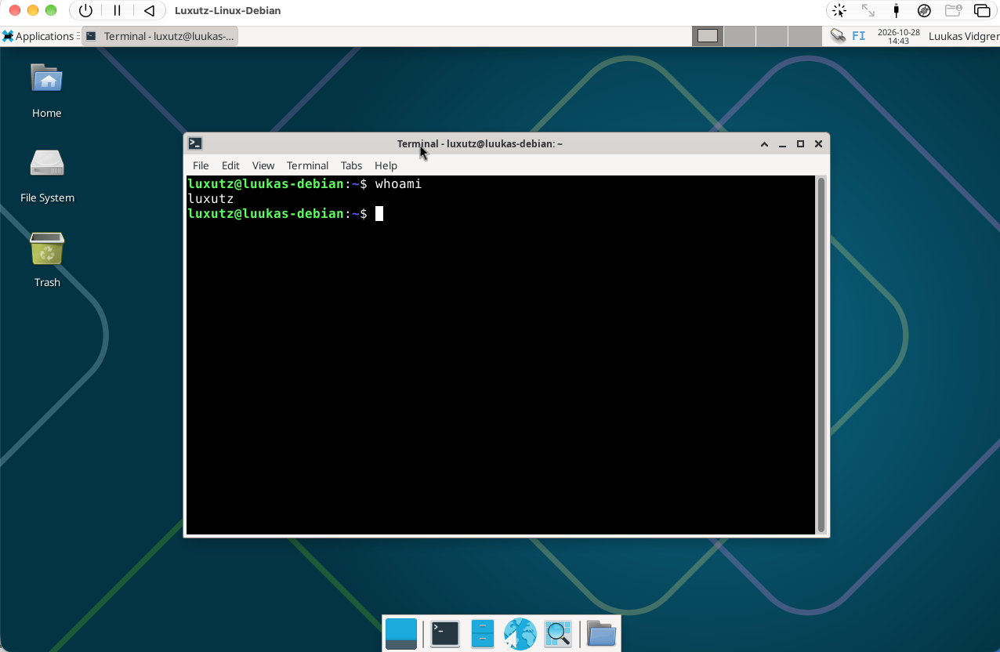
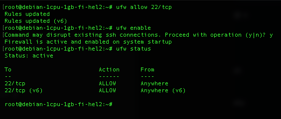
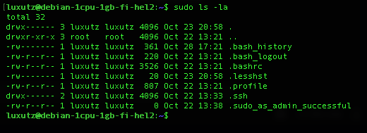
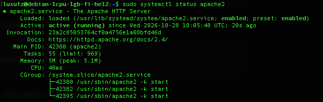

# h0 Oikeasti netissä

## Lue ja tiivistä

### Niemi 2025: H4 Tehtävät

Niemi käsitteli raportissaan H4 virtuaalipalvelimen vuokraamista, sekä siihen tehtäviä alkutoimia. Teknisesti tehtövö oli siis sama kuten tässäkin raportissa. 

* **VPS vuokraus ja ensikirjautuminen:** Raportissa vuokrataan pilvipalvelin ja kirjaudutaan sille ensimmäisen kerran root käyttäjänä (`ssh root@<palvelimen-ip>`). 
* **Tulimuurin (UFW) käyttöönotto:** Ennen tulimuurin käynnistämistä avataan reikä SSH-liikenteelle komennolla `sudo ufw allow 22/tcp`, jotta etäyhteys ei katkea. Tämän jälkeen tulimuuri otetaan käyttöön komennolla `sudo ufw enable` ja tila tarkistetaan komennolla `sudo ufw status`.
* **Oman sudo-käyttäjän luonti ja root-tilin sulkeminen:** Palvelimelle luodaan henkilökohtainen käyttäjätunnus komennolla `adduser <käyttäjänimi>` ja sille annetaan ylläpito-oikeudet sekä lokien lukuoikeudet komennoilla `adduser <käyttäjänimi> sudo` ja `adduser <käyttäjänimi> adm`. Root-tili lukitaan komennolla `sudo usermod --lock root` ja SSH-asetustiedostosta (`sudoedit /etc/ssh/sshd_config`) estetään suora root-kirjautuminen asettamalla `PermitRootLogin no` sekä käynnistetään SSH-demoni uudelleen (`sudo systemctl restart ssh`).
* **Järjestelmän päivittäminen ja weppipalvelin:** Pakettilistat päivitetään ja tietoturvapäivitykset asennetaan komennoilla `sudo apt-get update` ja `sudo apt-get upgrade`. Lopuksi asennetaan Apache2-weppipalvelin (`sudo apt-get install apache2`), avataan tulimuurista HTTP-portti (`sudo ufw allow 80/tcp`) ja muokataan oletussivua hakemistossa `/var/www/html/index.html`.
* **Oma huomio / kysymys:** Onko oikeasti pakollista lisätä  sudo-ryhmän lisäksi myös adm-ryhmään?

### Partanen 2025: Harjoitus 5: Nimekäs – a) Nimi

Partanen käsittelee raportissaan verkkotunnuksen eli domainin hankintaa

* **Verkkotunnuksen (domain) hankinta:** Partanen hankki julkisen verkkotunnuksen osoittamaan omaan virtuaalipalvelimeensa. Palveluntarjoajaksi valikoitui edullisen hinnan vuoksi Namecheap, josta hän rekisteröi `.space`-päätteisen domainin (`aleksipartanen.space`) noin yhden euron vuosihintaan (0,83 € + verot/kulut).
* **DNS-tietueiden konfigurointi (A-tietueet ja TTL):** Namecheapin hallintapaneelin *Advanced DNS* -näkymän *Host Records* -osiosta poistettiin oletuksena ollut tarpeeton `CNAME`-tietue ja luotiin tilalle `A Record` -tietueet, jotka ohjaavat liikenteen oman virtuaalipalvelimen julkiseen IPv4-osoitteeseen.
* **Host-arvot (`@` ja `www`):** Juuridomainia (`aleksipartanen.space`) varten asetettiin `Host`-kentän arvoksi `@` ja alidomainia (`www.aleksipartanen.space`) varten `www`. Molempien arvoksi (Value) asetettiin VPS-palvelimen IP-osoite, ja `TTL` (Time To Live) -arvoksi valittiin 5 minuuttia, jotta nimipalvelumuutokset päivittyvät ja näkyvät verkossa mahdollisimman nopeasti.
* **Oma huomio / kysymys:** Pieni TTL-arvo on kätevä käyttöönottovaiheessa ja IP-osoitteen vaihtuessa, mutta ei ehkä jatkuvassa käytössä.

---

## Debian 13 asennus UTM-virtuaalikoneeseen

Ensimmäinen varsinainen tehtävä oli asentaa Debian paikallisesti. Koska työasemani on Apple Silicon -arkkitehtuuriin pohjautuva MacBook Pro, perinteinen x86_64 (amd64) -virtualisointi on haastavaa. Päädyin kuitenkin emuloimaan toivoen, että myöhemmin tästä ei olisi haittaa. Emuloin myös siksi, koska kurssilla x86_64 arkkitehtuurin käyttäminen oli erittäin suositeltavaa. Emuloimiseen käytin macOS:lle tehtyä virtualisointi/emulointi ohjelmaa: UTM. Käytin tehtävässä pitkälti omaa osaamista UTM:n kanssa sekä Tero Karvisen artikkelia: Install Debian on Virtualbox (kts. lähteet)

### Asennuslevykuvan lataaminen
 Aloitin lataamalla Linuxin levykuvan: `debian-live-13.7.0-amd64-xfce` osoitteesta: https://cdimage.debian.org/debian-cd/current-live/amd64/iso-hybrid/. Käytin tätä levykuvaa Tero Karvisen ohjeen mukaisesti.

### Uuden virtuaalikoneen luonti UTM:ssä
1. Käynnistin UTM-sovelluksen ja klikkasin **+** (*Create a New Virtual Machine*).
2. **Start:** Valitsin **Emulate**
3. **Operating System:** Valitsin **Linux**.
4. **Linux-asetukset:**
   * Tässä kohtaa voi valita "raudan", mitä haluaa emuloida. Tässä tapauksessa UTM:n oletus on ns. normaali x86_64 pohjainen tietokone. 
   * Seuraavaksi valitaan ISO-tiedosto. Klikkasin **Browse...** kohdassa *Boot ISO Image* ja valitsin lataamani ISO-tiedoston. 
5. **Hardware:**
   * **Memory:** Asetin muistiksi `4096 MB` (4 Gt).
   * **CPU Cores:** Asetin ytimien määräksi `Default`. En nyt ole ihan varma monta corea käytössä; tuo tulee arvoksi, koska ns. UTM:n "pre-configuring". Valitsee siis parhaat asetukset, kun 3. kohdassa valitaan mitä OS:ssää käytetään.
6. **Storage:** Asetin virtuaalilevyn kooksi `60 GB` .
8. **Summary:** Annoin virtuaalikoneen nimeksi `Luxutz-Linux-Debian` ja klikkasin **Save**




### Debian 13 asennusprosessi
Käynnistin virtuaalikoneen ja annoin sen bootata automaattisesti **live**-tilaan. Koska kyseessä on **live**-image, voidaan Linuxia käyttää siis asentamatta sitä.


 

Avasin asennusohjelman (**Install Debian**) ja kävin asennusohjelman vaiheet läpi seuraavilla valinnoilla:
   * **Language:** `English` 
   * **Location:** `Europe` , `Helsinki - Finland`.
   * **Keyboard:** `Finnish (Macintosh)`.
   * **Partitions:** Valitsin valinnan: `Erase disk`, muuten menin ns. default valinnoilla. 
   * **Users:** Syötin asennusohjelman pyytämät tiedot eli: Koko nimi, käyttäjänimi sekä salasanan asetus

Asennus valmistui noin 10 minuutissa ja näytölle tuli ilmoitus *Installation complete*. Ennen kuin klikkasin Continue, irrotin asennus-ISO-levykuvan UTM:n yläpalkista: `Virtual Machine` -> `Drives` -> `CD/DVD` ->  **Eject**, jotta kone ei käynnisty uudelleen asennusmedialta.
Virtuaalikone käynnistyi uudelleen suoraan kirjautumisruutuun, kirjauduin sisään, jonka jälkeen pystyin varmistumaan, että asennus on suoritettu.




## VPS: Virtuaalisen yksityispalvelimen vuokraus (UpCloud)

Tämän tehtävän tarkoitus olikin sitten vuokrata VPS. Valitsin palveluntarjoajaksi suomalaisen **UpCloudin**, koska kyseisetä tarjoajasta oli puhetta tunnilla ja koska halpa ja selkeä hinnoittelu.

### 1. Palvelimen tilaaminen ja luonti
Aloitin luomalla tilin UpCloudiin, jonka jälkeen voitiin aloittaa palvelimen "tilaaminen" valinnasta **Deploy server**. 

Loin palvelimen jo tunnilla, joten kuvat unohtui. Tilaminen on kuitenkin helppoa ja meni kutakuinkin näin.
   * **Location:** `FI-HEL1`. Tässä tapauksessa hyvä, koska yhdistäminen nopeaa, muuten käyttäjäryhmän/lokaation mukaan.
   * **Plan:** Valitsin edullisimman **Starter** -paketin (1 CPU core, 1 GB RAM, 10GB storage, hinta n. 3€/kk).
   * **Operating System:** Valitsin **Debian** (Debian GNU/Linux 13 Trixie). Muitakin vaihtoehtoja on saatavilla, tämä siksi koska sitä kurssilla suositeltiin.
   * **Login method:** Tässä kohtaa valittiin kirjautumistapa. Turavllisuuden vuoksi valitsin: **SSH keys**. Lisäsin oman julkisen SSH-avaimen (`~/.ssh/id_ed25519.pub`), jonka pystyi sivulle vain copy&pastettaa. Itse SSH-avainten luonti onnistui terminaalissa `ssh-keygen` komennolla, jonka suorittamisen jälkeen julkinen ja yksityinen avain löytyivät `~/.ssh/` hakemistosta. Toteutin avainten luonnin paikallisesti omalla koneella macOS:n Terminaalissa.
   * **Hostname & Server name:** Nämä määrittyivät automaattisesti koneen speksien perusteella, enkä niihin tajunnut/jaksanut koskea.

Klikkasin **Deploy** ja parin minuutin jälkeen hallintapaneelista voitiin nähdä, että kone oli onnistuneetsi luotu.


---

## Alkutoimet: Sudo-käyttäjä, tulimuuri ja päivitykset

Tehtävässä oli tarkoitus tehdä ns. alkutoimet koneelle. Hyödynsin tehtävässä Tero Karvisen artikkelia: First Steps on a New Virtual Private Server – an Example on DigitalOcean and Ubuntu 16.04 LTS.  Aluksi kuitenkin otettiin yhteys pilvikoneeseen. Tämä tapahtui avaamalla terminaali ja ottamalla koneeseen ssh yhteys komennolla: `ssh root@80.47.236.224`. Pilvikoneen IP-osoite saatiin tietoon UpCloudin hallinta paneelista heti kun kone oli luotu.

Ennen käyttäjän luomista tarkistin ensin onko `ufw` ja `sudo` asennettuna. Debianin pilvi asennus on nimittäin yleensä hyvin pelkistetty, eikä välttämättä edes `sudo` ole asennettuna.  Asennukset tein alla olevilla komennoilla.

```bash
root@debian-1cpu-1gb-fi-hel2:~# apt-get update
root@debian-1cpu-1gb-fi-hel2:~# apt-get install ufw sudo
```


### Oman sudo-käyttäjän luominen
Aivan aluksi (jotta päästään "eroon" root käyttäjän käytöstä) loin palvelimelle oman henkilökohtaisen käyttäjän ja annoin sille vahvan salasanan. Uusi käyttäjä voitiin luoda helposti komennolla `adduser luxutz`.  

```bash
root@debian-1cpu-1gb-fi-hel2:~# adduser luxutz
```

Lisäsin käyttäjän `sudo`- ja `adm`-ryhmiin, jotta saisin omalle käyttäjälleni sudo oikeudet, sekä oikeudet lokien lukuun yms. 

```bash
root@debian-1cpu-1gb-fi-hel2:~# adduser luxutz sudo
root@debian-1cpu-1gb-fi-hel2:~# adduser luxutz adm

```

Lopuksi, koska käytin SSH-avainta, kopioin `root`-käyttäjän `authorized_keys`-tiedoston myös uudelle käyttäjälleni ja asetin tiedosto-oikeudet oikein, jotta pääsen kirjautumaan sisään SSH-avaimella `luxutz` käyttäjälle:

```bash
root@debian-1cpu-1gb-fi-hel2:~# mkdir -p /home/luxutz/.ssh # Loin ssh kansion käyttäjälle
root@debian-1cpu-1gb-fi-hel2:~# cp /root/.ssh/authorized_keys /home/omanimi/.ssh/ 
#Kopioin root:in ssh-avaimet käyttälälle luxutz
root@debian-1cpu-1gb-fi-hel2:~# chown -R luxutz:luxutz /home/omanimi/.ssh # Muutin hakemiston omistajan 
root@debian-1cpu-1gb-fi-hel2:~# chmod 700 /home/luxutz/.ssh
root@debian-1cpu-1gb-fi-hel2:~# chmod 600 /home/luxutz/.ssh/authorized_keys
# Muutetaan SSH-hakemiston ja avaintiedoston oikeudet niin, että vain luxutz omaa kaikki oikeudet, muut ei mitään
```

### Tulimuurin (UFW) käyttöönotto
Seuraavaksi otin käyttöön tulimuurin. Ennen käyttöönottoa kuitenkin varmistin, että se päästää SSH-yhetydet läpi. Tämä on erittäin tärkeää, sillä muuten lukitsee itsensä ulos koko koneelta. 



```bash
root@debian-1cpu-1gb-fi-hel2:~# ufw allow 22/tcp
root@debian-1cpu-1gb-fi-hel2:~# ufw enable
root@debian-1cpu-1gb-fi-hel2:~# ufw status
```


### Uuden käyttäjän ja sudon testaus ennen rootin lukitsemista
Enne kuin aloin sulkemaan `root` käyttäjää testasin, että oma käyttäjä toimii ja sillä on sudo oikeudet. 



Kirjautuminen ja `sudo` toimivat odotetusti, joten etenin lukitsemaan rootin.

### Root-tilin lukitseminen ja kirjautumisen estäminen
Ensin lukittiin `root` käyttäjä, sitten estettiin suora `root`-kirjautuminen SSH:n yli muokkaamalla OpenSSH-palvelimen asetustiedostoa `sudoedit`-komennolla ja muokkaamalla `PermitRootLogin yes` ja muutin sen muotoon: `PermitRootLogin no`. Lopuksi käynnistin SSH-palvelun uudestaan.

```bash
luxutz@debian-1cpu-1gb-fi-hel2:~$ sudo usermod --lock root
luxutz@debian-1cpu-1gb-fi-hel2:~$ sudoedit /etc/ssh/sshd_config
luxutz@debian-1cpu-1gb-fi-hel2:~$ sudo systemctl restart ssh
```

### Ohjelmien päivittäminen ja uudelleenkäynnistys
Lopuksi päivitin kaikki järjestelmän paketit uusimpiin versioihinsa tehtävän mukaisesti, tosin jos/kun olin tämän jo hieman aiemmin tehnyt, mikään ei oikeastaan päivittynyt.

```bash
luxutz@debian-1cpu-1gb-fi-hel2:~$ sudo apt-get update
luxutz@debian-1cpu-1gb-fi-hel2:~$ sudo apt-get upgrade
```

---

## Apache2 asennus ja testaus

Viimeisessä tehtävässä piti asentaa webbipalvelin. Valitsin asentaa Apache2 webpalvelimen. Aloitin asentamalla `apache2`-paketin paketinhallinnasta:

```bash
luxutz@debian-1cpu-1gb-fi-hel2:~$ sudo apt-get install apache2
```

Asennuksen valmistuttua tarkistin, että Apache-demoni on käynnissä:

```bash
luxutz@debian-1cpu-1gb-fi-hel2:~$ sudo systemctl status apache2
```



### 2. Tulimuurin avaaminen HTTP-liikenteelle
Koska `ufw`-tulimuuri oli päällä ja salli ainoastaan SSH-portin 22/tcp, nettisivulle ei vielä päässyt selaimella julkisesta verkosta. Avasin tulimuuriin reiän HTTP-liikenteelle (portti 80/tcp), jotta nettisivulle pääsee verkosta

```bash
luxutz@debian-1cpu-1gb-fi-hel2:~$ sudo ufw allow 80/tcp
```

Avasin tämän jälkeen selaimen ja siirryin osoitteeseen `http://80.47.236.224`. Ruudulle avautui Debianin Apache2 Default Page (*"It works!"*).

Jätin ns. default sivun vielä paikalleen, sillä tehtävässä pyydettiin vain apachen asennus.

## Lähteet

* Debian Project 2026. Downloading Debian. Luettavissa: https://www.debian.org/distrib/. Luettu: 28.10.2026.
* Karvinen, Tero 2006. Raportin kirjoittaminen. Luettavissa: https://terokarvinen.com/raportin_kirjoittaminen.html. Luettu: 28.10.2026.
* Karvinen, Tero 2017. First Steps on a New Virtual Private Server – an Example on DigitalOcean and Ubuntu 16.04 LTS. Luettavissa: https://terokarvinen.com/2017/first-steps-on-a-new-virtual-private-server-an-example-on-digitalocean/. Luettu: 28.10.2026.
* Niemi, A. 2025. H4 Tehtävät. Luettavissa: https://github.com/AONCODES/linux-course/blob/main/h4.md. Luettu: 28.10.2026.
* Partanen, Aleksi 2025. Harjoitus 5: Nimekäs: a) Nimi. Luettavissa: https://partanennn.github.io/linux-servers/practices/fifth-week.html. Luettu: 28.10.2026.
