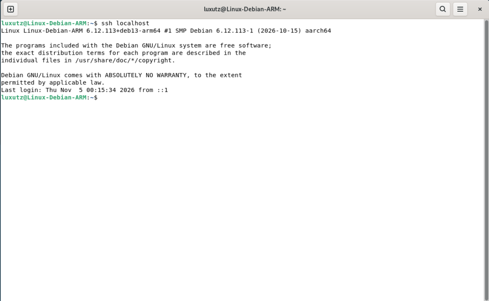
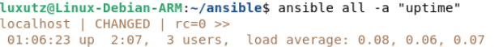
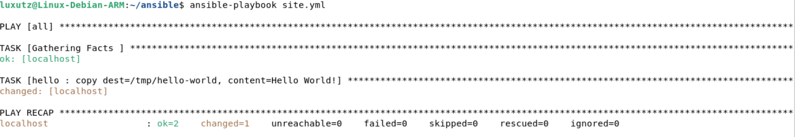

# h1 Hei ansiblen maailma

## Lue ja tiivistä

### Karvinen 2026: SSH public key - Login without password

* Salasanaton SSH-kirjautuminen perustuu avainpariin, joka koostuu yksityisestä avaimesta ja julkisesta avaimesta. Yksityinen avain pidetään aina salassa omalla koneella, kun taas julkinen avain voidaan kopioida turvallisesti kohdepalvelimille.
* **Tiivistetty prosessi :**
  *  Asennetaan ja testataan ssh komennoilla:
  ```bash
  sudo apt-get update
  sudo apt-get install ssh
  sudo systemctl enable --now ssh
  ssh localhost  
  ``` 
  * `ssh-keygen`: Luo uuden SSH-avainparin käyttäjän kotihakemiston `~/.ssh/`-kansioon.
  * `ssh-copy-id`: Kopioi oman julkisen avaimen kohdekoneen `~/.ssh/authorized_keys`-tiedostoon ja asettaa samalla automaattisesti oikeat oikeudet (`chmod 700 ~/.ssh` ja `chmod 600 ~/.ssh/authorized_keys`).


### Karvinen 2026: Hello Ansible

* **Infrastruktuuri koodina (IaC):** Ansible on konfiguraationhallintatyökalu, jolla voidaan hallita lukuisia eri tietokoneita. Ansible toimii SSH yhteyttä hyödyntäen
* **Asennus ja asetustiedostot:**
  * `sudo apt-get install ansible micro bash-completion tree`: Asentaa Ansiblen sekä työskentelyä nopeuttavat lisätyökalut.
  * `hosts.ini`: Lista hallittavista koneista (esim. `localhost`). 
  * `ansible.cfg`: Yleinen konfigurointi tiedosto.
* **Keskeiset komennot ja roolit:**
  * `ansible all -a "uptime"`: Suorittaa yksittäisen komennon kaikilla `hosts.ini`-tiedoston koneilla SSH-yhteyden yli.
  * `site.yml` (*Playbook*): Määrittää, mille koneryhmille (`- hosts: all`) mitkäkin roolit (`roles: - hello`) ajetaan.
  * `roles/hello/tasks/main.yml`: Roolin varsinainen koodi, joka suoritetaan automaattisesti, kun roolia kutsutaan.
  * `ansible-playbook site.yml`: Suorittaa tehtävän.
---

## Paikallista: Debian 13 (Trixie) asennus virtuaalikoneeseen

Asensin Debian:in jo aiemmin UTM:n tehtävässä [h0](https://github.com/luxutz/palvelinten-hallinta/blob/main/h0.md). Vaihdoin tässä tehtävien välissä kuitenkin käyttämään ARM versiota Debian:sta, sillä emuloitu `x86_64`osoittautui erittäin hitaaksi. Asennus oli jotakuinkin sama.

* **Levykuva:** Uusin ARM netinst levykuva.
* **Virtualisointiohjelmisto ja resurssit:** UTM (Virtualize -> Linux), 4096 MB RAM, 2 CPU-ydintä, 60 GB
* **Kieli, sijainti ja näppäimistö:** Kieli `English`, sijainti `Helsinki - Finland`, lokaali `en_US.UTF-8`, näppäimistö `Finnish`
* **Levyn osiointi:** `Guided - use entire disk` -> `All files in one partition`
* **Ohjelmistot (software):** `Debian desktop environment`, `GNOME`, `standard system utilities`, `ssh`

---

## Sshecrets: SSH-demonin asennus ja testaus

### SSH-palvelimen asennus

Valitsin SSH:n asennuksen jo Debian:in asennusvaiheessa, eli sitä ei travinnut enää erikseen asentaa. Päivitin kuitenkin paketit ja varmistin, että ssh on käynnissä. 

### SSH-kirjautumisen testaus (localhost)
SSH-yhteyden toimivuutta ottamalla yhteyden omaan koneeseeni (`localhost`):

```bash
$ ssh localhost
```

SSH-kirjautuminen onnistui heti, sillä loin SSH-avaimet heti asennuksen jälkeen.



---

## Pubkey: SSH-kirjautumisen automatisointi julkisella avaimella

### SSH-avainparin luominen
Loin avainparit komennolla `ssh-keygen`. Jotta kirjautuminen "automatisoituu" ja avain menee default lokaatioon painoin kaikkin valintoihin vain enteriä.

SSH-avaimet luotiin vakio hakemistoon `~/.ssh`. 

### Julkisen avaimen kopiointi kohdekoneelle
Seuraavaksi komennolla `ssh-copy-id localhost`tässä tapauksessa vain muutettiin oikeuksia, sillä avaimethan olivat jo samassa paikassa (koska `localhost`) 

---

## Hei Ansible: Hei maailma Ansiblella SSH:n yli

Asensin Ansiblen ja tein hei maailman kokonaan Tero Karvisen *Hello Ansible* -artikkelin mukaisesti.

### Ansiblen yms asennus ja testaus
Asensin `ansible`-, `micro`-, `bash-completion`- ja `tree`-paketit:

```bash
$ sudo apt-get install -y ansible micro bash-completion tree
```


### Ansible hakemiston ja muiden tarvittavien tiedostojen ( `hosts.ini`, `ansible.cfg`) luonti ja muokkaus.
Loin kotihakemistooni `ansible/`-kansion

```bash
$ mkdir ansible/
```

Loin `hosts.ini`-tiedoston. Määritin hallittavaksi koneeksi `localhost` ja lisäsin suoraan `[all:vars]`osion, sillä suurella todennäköisyydellä python-varoitus tulisi.

```ini
localhost

[all:vars]
ansible_python_interpreter=/usr/bin/python3
```

Seuraavaksi loin `ansible.cfg`tiedoston, johon lisäsin `inventory = hosts.ini`, jotta  `-i hosts.ini`komentoa ei tarvitsisi käyttää. Jotta Ansible näyttää suoraan ruudulla ajettavat asiat, lisäsin: `display_args_to_stdout = true`

```cfg
[defaults]
inventory = hosts.ini
display_args_to_stdout = true
```

### Yhteyden testaus Ansiblella
Tässä kohtaa testasin, että Asniblen SSH-yhteys varmasti toimii komennolla:

```bash
$ ansible all -a "uptime"
```



### Playbookin (`site.yml`) ja `hello`-roolin luominen
Toimivuuden testaamisen jälkeen loin `site.yml`-tiedoston, joka määrittää, että kaikille koneille (`all`) ajetaan rooli `hello`:

```yaml
- hosts: all
  roles:
    - hello
```

Seuraavaksi loin roolin hakemiston `roles/hello/tasks/` ja sinne tiedoston `main.yml`, jonne tein `copy` tehtävän, joka luo tiedoston `/tmp/hello-ansible`:

```yaml
- copy:
    dest: /tmp/hello-world
    content: "Hello World!"
```

### Tehtävän suoritus

Lopuksi ajoin tehtävän ja varmistin vielä, että se toteutui
```bash
$ ansible-playbook site.yml  
```



```bash
$ cat /tmp/hello-world
```

---

## Lähteet

* Karvinen, Tero 2026. SSH public key - Login without password. Luettavissa: https://terokarvinen.com/ssh-public-key-login-without-password/. Luettu: 4.11.2026.
* Karvinen, Tero 2026. Hello Ansible. Luettavissa: https://terokarvinen.com/hello-ansible/. Luettu: 4.11.2026.
