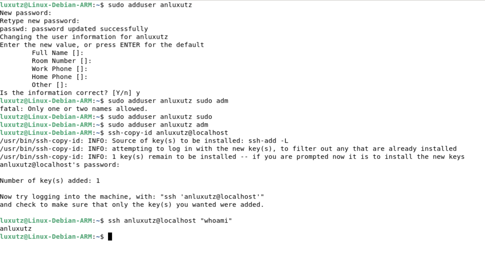
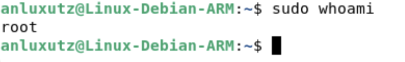
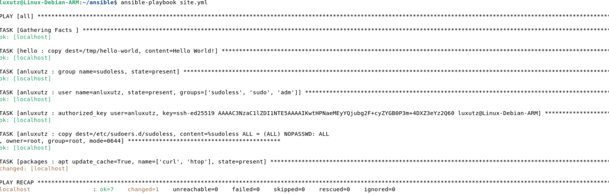
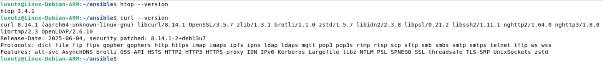
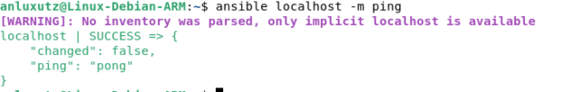

# h2 Voileipä

## Lue ja tiivistä

### Karvinen 2026: Sudo without password
Ansiblea varten on "pakko" olla käyttäjä, jolla voi käyttää `sudo`-komentoja ilman salasanan syöttämistä. Näin ollen voidaan ajaa kaikkia mahdollisia tehtäviä orjilla.
* **Prosessi:**
  * Luodaan `sudoless`-ryhmä, johon lisätään käyttäjä.
  * Luodaan `sudoers`-sääntö, joka antaa ko. ryhmälle oikeudet `sudo`:on ilman salasanaa.

```bash
sudo visudo /etc/sudoers.d/sudoless

#Lisätään teksti:
%sudoless ALL = (ALL) NOPASSWD: ALL
```

* **Oma huomio:** Kerrankin jokseenkin selkeä lisätyn säännön syntaksi :)

### Munroe 2006: xkcd 149: Sandwich
* Kyseessä on huumorillinen sarjakuva, joka selkeästi selittää sudon perusperiaatetta
* Kun kysytään:  "make me a sandwich.", vastaus on "kielteinen".
* Kun kysytään "sudo make me a sandwhich", vastaus on myönteinen. 
* **Oma huomio:** Sarjakuva selittää hyvin kuinka `sudo`antaa `root`-oikeudet. Eli aina kun laittaa sudon komennon eteen, komento ajetaan kyselemättä.

### Karvinen 2026: Passwordless Sudo with Ansible
* Automatisoidaan uuden salasanattoman sudo-käyttäjän luonti, jotta Ansiblella voidaan hallita orjia täysin automaattisesti ilman salasanakyselyitä.
* **Keskeiset vaiheet:**
  * Luodaan uusi rooli johon määritetään `sudoless`-ryhmän ja uuden käyttäjän luonti. Määritetään SSH julkinen avain käyttäjälle, sekä kirjoitetaan määritys sudoers ryhmälle.
  * Lisätään `site.yml`-tiedostoon `become: true`, joka kertoo Ansiblelle, että kaikki tehtävät suoritetaan kohdekoneella `sudo`-oikeuksilla.
* **Oma huomio:** Kätevää, mutta onkohan tässä turvallisuusriskejä?

---

### Ansiblen sisäänrakennettu dokumentaatio (`ansible-doc`)

#### `ansible-doc copy`
* Kopioi tiedoston paikalliselta koneelta tai etäkoneelta etäkoneelle.
* **Optiot:**
  * `content`: Määrittää tiedoston sisällön suoraan tekstinä.
  * `dest`: Absoluuttinen polku kohdekoneella, johon tiedosto kopioidaan.
  * `src`: Paikallinen polku tiedostoon tai kansioon, joka halutaan kopioida kohdekoneelle. 
  * `owner`: Tiedoston omistavan käyttäjän nimi
  * `group`: Tiedoston omistavan ryhmän nimi
  * `mode`: Tiedoston käyttöoikeudet
* **Esimerkki:**

```yaml
  - name: Copy file with owner and permissions
    ansible.builtin.copy:
      src: /srv/myfiles/foo.conf
      dest: /etc/foo.conf
      owner: foo
      group: foo
      mode: '0644'
```

#### `ansible-doc apt`
* Hallitsee ohjelmistopaketteja mm. Debian- ja Ubuntu-pohjaisissa järjestelmissä. 
* **Nimetyt optiot:**
  * `name`: Paketin/paketteien nimi.
  * `state`: Määrittää paketin halutun tilan, esim. `present` (asennettu), `absent` (poistettu) tai `latest`( uusin versio).
  * `update_cache`: Päivittää paketit (`apt-get update`) ennen tehtävää
* **Esimerkki:**
```yaml
  - name: Install apache httpd (state=present is optional)
    ansible.builtin.apt:
      name: apache2
      state: present
```

#### `ansible-doc file`
* Tiedostojen tai hakemistojen luonti, poisto ja muokkaus.
* **Optiot:**
  * `path`: Polku hallittavaan tiedostoon tai hakemistoon (pakollinen).
  * `recurse`: Asettaa tiedosto-oikeudet myös alikansioille hakemiston sisällölle (`true`/`false`).
  * `src`: Linkitettävän lähdetiedoston polku
  * `state`: Määrittää kohteen tilan, esim. `directory`, `touch`, `link`, `absent` (poistaa kohteen) tai `file`.
  * `owner`: Tiedoston tai hakemiston omistaja.
  * `group`: Tiedoston tai hakemiston omistava ryhmä.
  * `mode`: Tiedoston tai hakemiston käyttöoikeudet.
* **Esimerkki:**
  ```yaml
  - name: Create a directory if it does not exist
    ansible.builtin.file:
      path: /etc/some_directory
      state: directory
      mode: '0755'
  ```

#### `ansible-doc user`
* Käyttäjien luonti, poisto ja hallinointi.
* **Optiot:**
  * `name`: käyttäjän käyttäjätunnus (pakollinen).
  * `create_home`: Luo käyttäjälle kotihakemiston (`true`/`false`, oletuksena `true`).
  * `comment`: Käyttäjän kuvaus
  * `groups`: Ryhmät joihin käyttäjä lisätään
  * `shell`: Oletuskomentotulkki
  * `state`: `present`luo ja`absent`poistaa
  * `system`: Järjestelmäkäyttäjän luonti (`true`)
* **Esimerkki:**
  ```yaml
  - name: Add the user 'johnd' with a specific uid and a primary group of 'admin'
    ansible.builtin.user:
      name: johnd
      comment: John Doe
      uid: 1040
      group: admin
  ```

#### `ansible-doc authorized_key`
* Lisää tai poistaa julkisia SSH-avaimia tietyn käyttäjätilin `authorized_keys`-tiedostosta.
* **Optiot:**
  * `user`: Käyttäjätunnus, jolle lisätään SSH-avain
  * `key`: SSH-avain itsessään
* **Esimerkki:**
  ```yaml
  - name: Set authorized key taken from file
    ansible.posix.authorized_key:
      user: charlie
      state: present
      key: "{{ lookup('file', '/home/charlie/.ssh/id_rsa.pub') }}"
  ```

**Oma huomio:**
`ansible-doc` on hyvin laaja "ohjekirja", eli käytännössä muita ohjeita ansiblen käyttöön ei teknisesti tarvitse.

---

## Sudoless: Salasanaton sudo-tunnus Ansiblea varten

Tehtävänä oli luoda Ansiblea varten erillinen tunnus, jolla sekä SSH-kirjautuminen että `sudo`-käyttö ilman salasanaa.

Aloitin luomalla uuden käyttäjän nimeltä `anluxutz` ja kopioin sille SSH-avaimen:

```bash
$ sudo adduser anluxutz
$ sudo groupadd sudoless
$ sudo adduser anluxutz sudoless
$ ssh-copy-id anluxutz@localhost
$ ssh anluxutz@localhost "whoami"
anluxutz
```

 
Kuvassa lisäsin vahingossa käyttäjän manuaalisesti sudo-ryhmään. Näin ei kuitenkaan kuulu tehdä

### Salasanattoman sudon määritys
Seuraavaksi lisäsin käyttäjälle oikeuden käyttää `sudo`-komentoa ilman salasanaa luomalla tiedoston `/etc/sudoers.d/sudoless`  ja lisäämällä sinne tekstin:

```bash
$ sudo visudo -f /etc/sudoers.d/sudoless

# sudoless ALL=(ALL) NOPASSWD: ALL
```



---
## Antero: Tee salasanaton, automaattisesti SSH:lla kirjautuva tunnus Ansiblella

Seuraavaksi tarkoituksena oli automatisoida Ansiblella käyttäjän luonti, jolla on salasanaton tili ja automaattinen SSH-kirjautuminen. Tehtävänanto oli hieman hämmentävä, että pitikö tässä siis tehdä a) osassa yksi ja b) osassa toinen käyttäjä. Tein kuitenkin nyt siis tässä saman automosoidusti käytännössä kuin edellisessä tehtävässä.

### Roolin `anluxutz` ja `site.yml` muokkaus
Aloitin niin ikään hieman käänteisesti eli muokkasin`site.yml`-tiedostoa lisäämällä sinne `become: true`, jotta Ansible käyttää sudoa aina automaattisesti sekä uuden roolin `anluxutz`:

```yaml
- hosts: all
  become: true
  roles:
    - hello
    - anluxutz
```

Loin roolin ja tehtävän:

```bash
$ micro roles/anluxutz/tasks/main.yml
```


```yaml
- group:
    name: "sudoless"
    state: present
- user:
    name: "anluxutz"
    state: present
    groups: ["sudoless", "sudo", "adm"]
- authorized_key:
    user: "anluxutz"
    key: "ssh-ed25519 AAAAC3NzaC1lZDI1NTE5AAAAIKwtHPNaeMEyYQjubg2F+cyZYGB0P3m+4DXZ3eYz2Q60 luxutz@Linux-Debian-ARM"
- copy:
    dest: "/etc/sudoers.d/sudoless"
    content: "%sudoless ALL = (ALL) NOPASSWD: ALL\n"
    owner: "root"
    group: "root"
    mode: "0644"

```

### Tehtävän suoritus
Lopuksi ajoin playbookin. Muokkasin komentoa kuitenkin niin, että se kysyy sudo-salasanan. Testasin myös vielä, että kirjautuminen toimii.

```bash
$ ansible-playbook site.yml -K
$ ssh anluxutz@localhost whoami
anluxutz
```

En ollut ihan varma oliko tämä tarkoitus, mutta laitoin salasanattoman `sudo`:n vielä käyttöön lisäämällä `ansible.cfg` tiedostoon rivin (`remote_user = anluxutz`), joka pistää ansiblen ns. ajamaan tehtävät käyttäjällä, jolla salasanaton `sudo`-oikeus on :

```cfg
[defaults]
inventory = hosts.ini
display_args_to_stdout = true
remote_user = anluxutz
```
---

## Package: Kahden paketin asentaminen Ansiblella

Päätin tässä tehtävässä asentaa  `curl`- ja `htop`-ohjelmat.

### Roolin `packages` luonti ja tehtävän teko

Aloitin lisäämällä `site.yml`:iin taas uuden roolin. Loin kansion `roles/packages/tasks/` ja sinne `main.yml`-tiedoston, jossa käytin `apt`-moduulia:

```yaml
- apt:
    update_cache: true
    name:
      - curl
      - htop
    state: present
```

### Suoritus ja onnistunut asennus
Lopuksi ajoin playbookin ja varmistin pakettien asentumisen `--version` komennolla:





---

## File: Useamman rivin tiedosto ja oikeudet Ansiblella

Tehtävänä oli kirjoittaa orjalle useamman rivin mittainen tiedosto Ansiblella sekä määrittää sen omistaja, ryhmä ja oikeudet oktaalimuodossa.

### Tiedoston määrittely `copy`-moduulilla
Lisäsin taas uuden roolin ja loin tehtävän (`roles/teksti/tasks/main.yml`), joka luo useampirivisen tiedoston `/home/anluxutz/tekstia.txt`. Käytin pystyviivaa (`|`), jotta rivinvaihdot säilyvät, ja asetin omistajaksi `anluxutz`, ryhmäksi `anluxutz` ja oikeuksiksi `"0640"`:

```yaml
- copy:
    dest: /home/anluxutz/tekstia.txt
    owner: anluxutz
    group: anluxutz
    mode: "0640"
    content: |
      Testiteksti
      Jee!
      Meniköhän oikein?
```

### Suoritus ja oikeuksien tarkistus
Ajoin taas playbookin ja tarkistin luodun tiedoston tiedot ja sisällön:

```bash
$ ansible-playbook site.yml
$ ssh anluxutz@localhost
$ ls -la tekstia.txt
$ cat tekstia.txt
```


### Oikeuksien selitys: `-rw-r-----`
* **Symbolinen muoto:** `-rw-r-----`
  * Ensimmäinen merkki `-` kertoo, että kyseessä on tavallinen tiedosto.
* **Omistaja: `rw-`**
  * Tiedoston omistaja saa **lukea** (`r`) ja **muokata** (`w`) tiedostoa, mutta ei ns. suorittaa (`-`).
* **Omistava ryhmä:`r--`**
  * Käyttäjät, jotka kuuluvat `anluxutz`-ryhmään, saa **lukea** (`r`) tiedoston sisällön, mutta ei muokata sitä tai suorittaa sitä.
* **Muut käyttäjät: `---`**
  * Muilla käyttäjillä ei ole mitään oikeuksia tiedostoon.

---

## Jotain muuta.

Testasin viimeisessä kohdassa vaihteluksi ns. ad-hoc komentoa `ping`:

```bash
ansible localhost -m ping
```



---

## Lähteet

* Karvinen, Tero 2026. Palvelinten Hallinta Luettavissa: https://terokarvinen.com/palvelinten-hallinta/ Luettu 9.11.2026
* Ansible Doc 2026. `ansible-doc copy`, `apt`, `file`, `user`, `authorized_key`). Luettu: 9.11.2026.
* Karvinen, Tero 2026. Sudo without password. Luettavissa: https://terokarvinen.com/sudo-without-password/. Luettu: 9.11.2026.
* Karvinen, Tero 2026. Passwordless Sudo with Ansible. Luettavissa: https://terokarvinen.com/passwordless-sudo/ Luettu: 9.11.2026.
* Munroe, Randall 2006. xkcd 149: Sandwich. Luettavissa: https://xkcd.com/149/. Luettu: 9.11.2026.
* McBrien, Scott. Linux file permissions explained. Luettavissa: https://www.redhat.com/en/blog/linux-file-permissions-explained. Luettu 9.11.2026