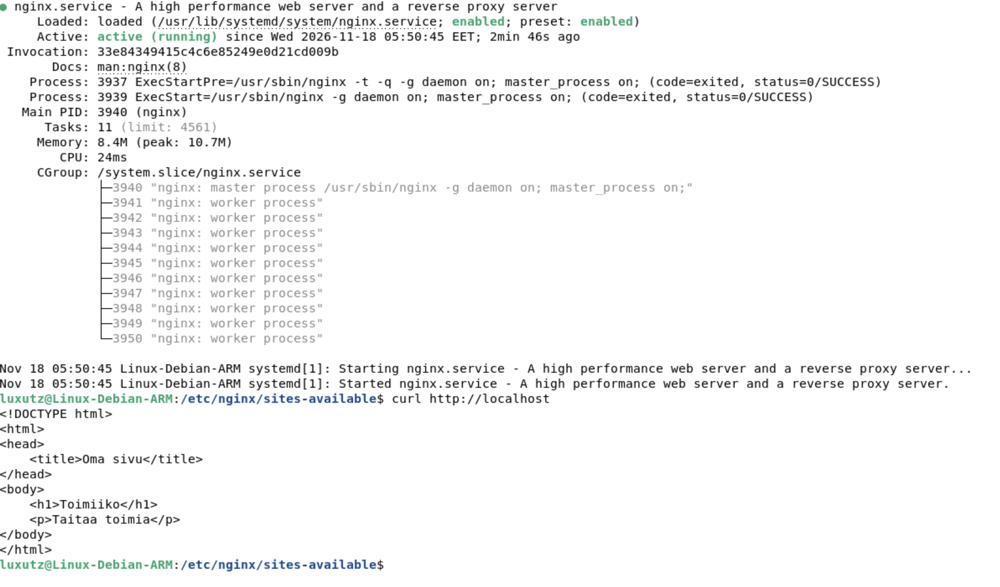
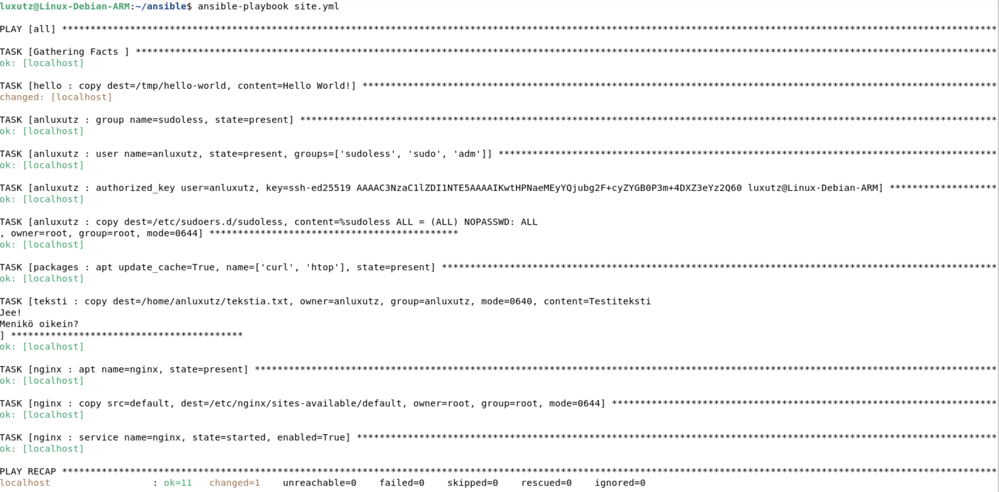

# h3 Demoni

## Lue ja tiivistä

### Karvinen 2026: Apache installed with Ansible - quick notes
* Artikkelissa selitetään **package-file-service** -malli, jolla esim Apache2 asennetaan ja konfiguroidaan Ansiblella.
 * **Package:** Asennetaan `apache2` tavaliisesti
  * **File:** Konfiguroidaan eli muokataan tiedostoja. Määritetään mm. aktiivinen sivu ja konfiguroidaan sen sijainti.
  * **Service:** Käytetään `handlers`:ja, joilla voidaan automatisoida demonin uudelleenkäynnistys aina jos tiedostoja muutetaan. 
* **Oma huomio:** Aika haastavalta näyttää, mutta oppii varmasti ajan kanssa.

### Ansible Community Documentation: Handlers: running operations on change
* **Handlers:** Asniblessa voidaan käyttää näitä tilanteissa, jolloin tehtävä halutaan suorittaa vain silloin, kun kohdekoneella tapahtuu jokin muutos. Esimerkiksi demonin uudelleenkäynnistys vain silloin, jos siihen liittyviä tiedostoja muokataan. 
* **Notifying handlers:**
  * Yhtä tai useampaa handleria kutsutaan `notify`-avainsanalla.
  * Vaikka useampi tehtävä kutsuisi samaa handleria saman playbook-ajon aikana, Ansible suorittaa handlerin vain yhden kerran.
* **Oma huomio:** Kätevää, että suoritus tapahtuu vain kerran. Ilmeisesti on siis turhaa kirjoittaa `notify`jokaiseeen tehtävään.

### `ansible-doc service`
* Hallitsee palveluita (daemons/services) etäkoneilla. Toimii ns. proxynä, eli moduuli osaa käyttää useita eri "spesifimpiä" palvelun hallinta moduuleita (esim: `systemd`yms)
* **Optiot:**
  * `enabled`: Määrittää, käynnistyykö palvelu automaattisesti koneen käynnistyessä (`true` tai `false`).
  * `name`: Hallittavan palvelun nimi.
  * `state`: Palvelun haluttu tila: `started` (käynnistää palvelun, jos se ei ole käynnissä), `stopped` (pysäyttää palvelun), `restarted` (käynnistää palvelun aina uudelleen) tai `reloaded` (lataa asetukset uudelleen).
* **EXAMPLE:** Palvelun käynnistys
  ```yaml
  - name: Start service httpd, if not started
    ansible.builtin.service:
      name: httpd
      state: started
  ```
* **Oma huomio:**: Kuten ohjeessa sanotaan, `started`ja `stopped` ovat idempotentteja, eli ne ei tee mitään, jos palvelu on jo halutussa tilassa. Sen sijaan `restarted` käynnistää palvelun uudelleen joka ikisellä kerralla.

---

## Infra-uutiset: Keskitetty hallinta Hacker Newsissa

Valitsin artikkeliksi: [Enroll, a tool to reverse-engineer servers into Ansible config mgmt](https://news.ycombinator.com/item?id=46449852)

* Artikkeli käsitteli työkalua, jolla voidaan ns. muuntaa palvelimia, joissa ei ole käytössä minkäänlaista keskitettyä hallintaa käyttämään Ansiblea.
* Työkalu lukee olemassa olevan palvelimen tiedot kuten paketit, palvelut ja tiedostot ja osaa luoda sen perusteella automaattisesti Ansible roolit, playbookit yms.

---

## Apassi: Apache 2 asennus ja konfigurointi käsin

Tehtävänä oli asentaa Apache 2 käsin niin, että weppisivu näkyy suoraan palvelimen etusivulla (`http://localhost`) ja sivua pystyy muokkaamaan tavallisella käyttäjällä ilman `sudo`-oikeuksia.

### Apache2-paketin asennus
Päivitin pakettilistat ja asensin `apache2`-paketin:

```bash
sudo apt-get update
sudo apt-get install -y apache2
```


### Kotisivukansion luonti tavallisena käyttäjänä
Asennuksen jälkeen loin kotihakemistooni kansion sivulle `publicsites` ja sinne `index.html`-tiedoston

```bash
mkdir -p /home/luxutz/saitti
micro /home/luxutz/saitti/index.html
```

Kirjoitin `index.html`-tiedostoon lyhyen testisisällön:

```html
<!DOCTYPE html>
<html>
<head>
    <title>Oma sivu</title>
</head>
<body>
    <h1>Toimiiko</h1>
    <p>Taitaa toimia</p>
</body>
</html>
```

Muutetaan lopuksi vielä tehtävänanto sivun vinkkejä noudattaen kyseisen tiedoston oikeudet niin, että webbipalvelin (apache2) pääsee näkemään sen. Tämä täytyy tehdä koska oma sivuni on minun omistama eikä palvelinta pyrittävän käyttäjän tai ryhmän (`www-data:www-data`)

```bash
chmod ugo+x /home/luxutz/
chmod ugo+x /home/luxutz/saitti/
chmod ugo+r /home/tero/saitti/index.html
```

### Konfigurointi-tiedoston luonti ja enablointi
Kokeilin luoda omalle sivulleni kokonaan uuden/oman asetustiedoston, joka kertoo `Apache`:lle mistä sivu löytyy.

```bash
sudo micro /etc/apache2/sites-available/luxutz.conf
```

Lisäsin tiedostoon asetukset:

```conf
<VirtualHost *:80>
    DocumentRoot /home/luxutz/saitti/
    <Directory /home/luxutz/saitti/>
        Require all granted
    </Directory>
</VirtualHost>
```

Jotta saisin oman sivuni näkyviin poistin Apachen oletussivuston (`000-default.conf`) käytöstä, otin oman `luxutz.conf`-sivuston käyttöön ja "reloadasin" Apachen:

```bash
sudo a2dissite 000-default.conf
sudo a2ensite luxutz.conf
sudo systemctl reload apache2
```

Lopuksi testasin Apachen ja oman sivun toimivuuden selaimella menemällä osoitteeseen:  `http://localhost`:


---

## Moottorix: Nginx asennus ja konfigurointi käsin

Seuraavaksi tehtävänä oli asentaa Nginx samoin periaattein kuin Apache edellisessä tehtävässä.

### Apachen sammuttaminen ja Nginxin asennus
Koska webpalvelimet käyttää tietenkin liikenteeseen samoja portteja sammutin ensin `Apache2`:n ja disabloin sen.

```bash
sudo systemctl stop apache2
sudo systemctl disable apache2
sudo apt-get install -y nginx
```

### Nginxin asetustiedoston
En jaksanut alkaa tutustua `nginx`:n konfigurointiin, joten muokkasin vain oletus konfigurointi tiedostoa käyttämään edellisessä tehtävässä luotua sivustoa oletus-sivun sijaan. Käytin `default`-konfiguraatiosta löytyvää esimerkkiä, johon sijoitin tarvittavat polut ja positin muun. Otin kuitenkin säästöön kaiken alkuperäisen tekemällä kopion. Itseasiassa kirjoittaessani huomasin, että tutustuin sittenkin (tavallaan):

```bash
sudo cp /etc/nginx/sites-available/default default_og
sudo micro /etc/nginx/sites-available/luxutz.conf
```

Jätin asetustiedostoon ja muokkasin:

```nginx
server {
    listen 80 default_server;
    listen [::]:80 default_server;

    root /home/luxutz/saitti;
    index index.html;

    server_name _;
}
```

Lopuksi reloadasin ja testasin sivun toimivuuden `curl`:ia käyttäen, jotta voidaan nähdä sivun varmasti pyörivän `nginx`-palvelimella:

```bash
sudo systemctl reload nginx
curl http://localhost
```




---

## Automoottorix: Nginx-asennuksen automatisointi Ansiblella

Viimeisenä tehtävänä oli automatisoida Nginxin asennus ja konfigurointi Ansiblella. Noudatin tehtävässä `package-file-service`-rakennetta kuten Tero Karvinen artikkelissaan: Apache installed with Ansible - quick notes

### Roolin ja hakemistorakenteen luonti
Aloitin luomalla `nginx`-roolin ja sille kansiot `files/`, `handlers/` ja `tasks/`:

```bash
mkdir -p roles/nginx/files roles/nginx/handlers roles/nginx/tasks
```

### Asetustiedosto (`roles/nginx/files/default`)
Käytin samaa asetustiedostoa, jonka loin edellisessä tehtävässä.

```bash
cp /etc/nginx/sites-available/default roles/nginx/files/default
```

### Handler (`roles/nginx/handlers/main.yml`)
Loin handlerin, joka käynnistää Nginxin uudelleen vain silloin, kun asetustiedostoihin tulee muutoksia:

```yaml
- name: restart nginx
  service:
    name: nginx
    state: restarted
```

### Tehtävät (`roles/nginx/tasks/main.yml`)
Lopuksi loin itse tehtävät,  jotka varmisttaa, että Nginx on asennettu, konfigurointi tiedosto on oikea ja että Nginx on käynnissä. Lisäsin roolin tietenkin itse `site.yml`-tiedostoon:

```yaml
- apt:
    name: nginx
    state: present

- copy:
    src: default
    dest: /etc/nginx/sites-available/default
    owner: root
    group: root
    mode: "0644"
  notify: restart nginx

- service:
    name: nginx
    state: started
    enabled: true
```


### Tehtävän suoritus
 
Lopuksi ajoin playbookin ja testain, että sivu toimii.

```bash
ansible-playbook site.yml
curl http://localhost
```




---

## Lähteet

* Karvinen, Tero 2026. Palvelinten Hallinta Luettavissa: https://terokarvinen.com/palvelinten-hallinta/. Luettu 18.11.2026
* Ansible Community Documentation 2026. Handlers: running operations on change. Luettavissa: https://docs.ansible.com/projects/ansible/latest/playbook_guide/playbooks_handlers.html. Luettu: 18.11.2026.
* Ansible Doc 2026.  (`ansible-doc service`). Luettu: 18.11.2026.
* "_mig5" 2026. Enroll, a tool to reverse-engineer servers into Ansible config mgmt. Luettavissa: https://news.ycombinator.com/item?id=46449852 Luettu: 18.11.2026.
* Karvinen, Tero 2026. Apache installed with Ansible - quick notes. Luettavissa: https://terokarvinen.com/apache-ansible/. Luettu: 18.11.2026.
