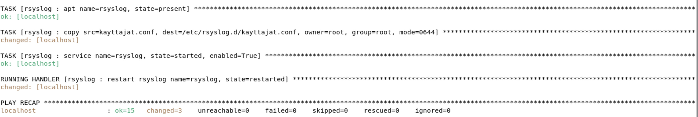
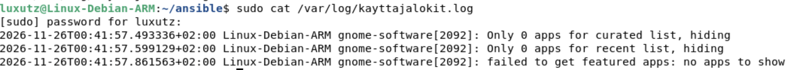
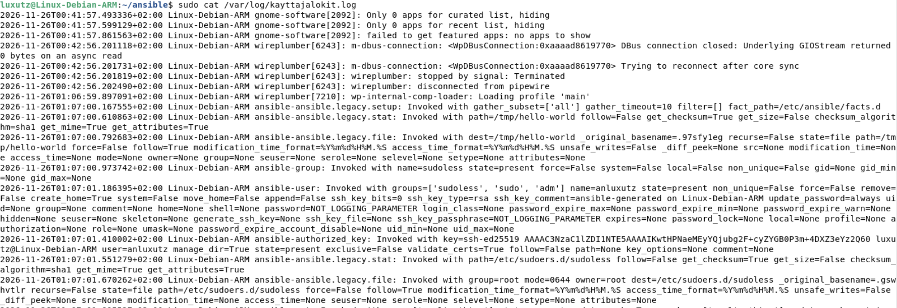
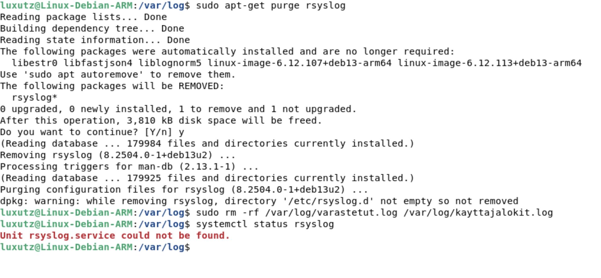
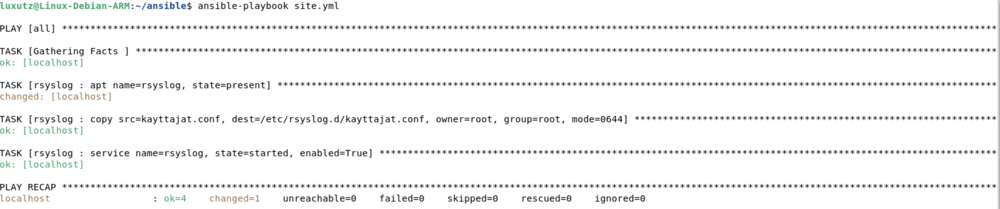
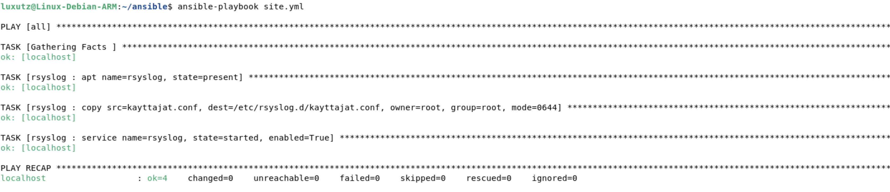

# h4 Räpylä

## Lue ja tiivistä

### Karvinen 2023: Configuration Management of Distributed Systems over Unreliable and Hostile Networks

#### 4.12.1 Size and Complexity of Some DSLs (s. 112 – Ominaisuuksien määrä)
* Konfiguraationhallintajärjestelmät käyttää ns. omia täsmäkieliään eli DSL:iä, jotka ovat valtavan laajoja. Esimerkiksi Salt sisältää valtavan  sisäänrakennetun funktiokirjaston.
* Valtava ominaisuuksien määrä tekee työkaluista raskaita oppia ja ylläpitää
* **Oma huomio:** Olettaisin, että perusmoduuleilla pärjää varmasti pitkälle "oikeassa elämässä"
#### 4.12.2 Use of DSL Functions in Case Configuration (s. 112–115 – Mitä oikeasti käytetään)
* Vaikka ominaisuuksia on lukuisia, tutkittaessa oikean elämän käyttötarkoituksia, voidaan huomata, että vain murto-osaa niistä käytetään.
* Tutkittaessa voidaan huomata, että vaikka työkaluissa on tuhansia toimintoja, suurin osa todellisesta konfiguraatiosta koostuu vain muutamasta perustoiminnosta kuten: `case`, `file``package`ja `exec`. 36 käytetyintä toimintoa muodostaakin 87% kaikkien käytettyjen toimintojen osuudesta.
* **Oma huomio:** Kuten edellellisessä huomiossa, oikeassa käytössä siis pärjää pitkälle opettelemalla vain käytetyimmät ominaisuudet.
#### 4.12.3.1 Dependencies Between Main Functions (s. 115–117 – Tärkeimmät rakennuspalikat)
* Konfigurointi perustuu riippuvuuksiin funktioiden välillä
* Yleisimpiin funktioihin kuuluu: `package-file-service`, `user`, `group` ja `exec`.
* Järjestelmän on tärkeää olla idempotentti ja helppo käyttöinen käyttäjälle.
* Perusfunktioita voidaan hyödyntää myös korkeamman tason funktioissa, joten miksi kaikesta on tehty niin haastavaa.
* **Oma huomio:** On mielenkiintoista, miksi on alunperin kehitetty niin paljon erilaisia funktioita, kun niitä ei oikeastaan tarvita?

---

## Räpylä:`rsyslog` asennus ja testaus käsin

Valitsin asennettavaksi demoniksi **Rsyslog-lokidemonin** (`rsyslog`), joka kirjoittaa järjestelmän ja sovellusten lokiviestejä automaattisesti tiedostoihin. Demonilla pytytään lukemaan, prosessoimaan ja lähettämään lokeja hyvin laajasti.

### Paketin asennus
Päivitin pakettilistat ja asensin `rsyslog`-paketin, sekä testasin sen toimivuuden:
```bash
sudo apt-get update
sudo apt-get install rsyslog
sudo systemctl status rsyslog
```

### Asetustiedoston luonti käsin (`/etc/rsyslog.d/`)
Testasin demonin käyttöä luomalla asetustiedoston joka vie kaikki lokit omaan määritettyyn paikkaan. Loin oman asetustiedoston `/etc/rsyslog.d/varastus.conf`, joka ohjaa lokiviestit lokitiedostoon `/var/log/varastetut.log`. Tässä tapauksessa loin konfiguraation `rsyslog.d`kansioon eli en poistanut tai muokannut oikeaa `.conf`-tiedostoa.:

```bash
sudo micro /etc/rsyslog.d/varastus.conf
```

Kirjoitin tiedostoon rivin:

```.conf
*.* /var/log/varastetut.log
```

 Lopuksi käynnistin demonin uudelleen:

```bash
$ sudo systemctl restart rsyslog
```

### Demonin toiminnan testaus
Lopuksi testasin demonin toimintaa lähettämällä käsin testilokiviestin `logger`-komennolla ja luin luodun lokitiedoston sisällön:

```bash
logger "testailu"
sudo grep "testailu /var/log/varastetut.log
```

---

## b) Automaatti: `rsyslog`-asennuksen automatisointi Ansiblella

Seuraavaksi automatisoin `rsyslog`asennuksen ja määrityksen, että kaikki `user`-lokit ohjataan omaan tiedostoon.

### Roolin luonti (`roles/rsyslog/`)
Aloitin luomalla `/ansible/roles/rsyslog/`-hakemistorakenteen:

```bash
mkdir -p roles/rsyslog/files roles/rsyslog/handlers roles/rsyslog/tasks
```

1. **Konfigurointi-tiedosto** (`roles/rsyslog/files/kayttajat.conf`):**
   ```conf
   user.*    /var/log/kayttajalokit.log  
   ```

2. **Handler (`roles/rsyslog/handlers/main.yml`):**
   ```yaml
   - name: restart rsyslog
     service:
       name: rsyslog
       state: restarted
   ```

3. **Tehtävät (`roles/rsyslog/tasks/main.yml`):**
   ```yaml
   - apt:
       name: rsyslog
       state: present

   - copy:
       src: kayttajat.conf
       dest: /etc/rsyslog.d/kayttajat.conf
       owner: root
       group: root
       mode: "0644"
     notify: restart rsyslog

   - service:
       name: rsyslog
       state: started
       enabled: true
   ```

4. **Playbook (`site.yml`):**
   ```yaml
   - hosts: all
     become: true
     roles:
       - rsyslog
   ```

Lopuksi ajoin playbookin ja testasin, että automaatio toimii:

```bash
ansible-playbook site.yml
sudo cat /var/log/kayttajalokit.log
```






Testatessa tulosta ihmettelin, että lokitiedostoon oli jo kirjautunut jotain. Tämä tietenkin johtui `user`-lokiluokasta, joka siis tarkoittaa kaikkia käyttäjiä, ei vain "ihmiskäyttäjiä"

---

## Asetus: Asetustiedoston muuttaminen

Testasin muokata hallintakoneella asetustiedostoa `roles/rsyslog/files/kayttajat.conf` niin, että se ohjaa sittenkin `kern`-luokan (kernel) lokit tiedostoon:

```conf
kern.* /var/log/kayttajalokit.log 
```

Ajoin lopuksi taas playbookin ja testasin, että lokitiedostoon on kirjoittunut `kern`-luokan lokeja:




---

## d) Paikka remonttiin

Rikoin kaiken  poistamalla `rsyslog`-demonin asetustiedostoineen `purge`-komennolla sekä poistamalla kaikki luodut lokitiedostot:

```bash
sudo apt-get purge rsyslog
sudo rm -rf /var/log/varastetut.log /var/log/kayttajalokit.log
```



Tämän jälkeen ajoin playbookin uudelleen. Ennen ajamista muokkasin kuitenkin `site.yml`-tiedostoa niin, että vain `rsyslog`-rooli suoritetaan siisteyden vuoksi:



Playbookin ajon jälkeen`rsyslog`asentui onninstuneesti takaisin, kuten kuuluikin. Purge ei kuitenkaan nähtävästi poistanut `rsyslog.d`-hakemistoa.

---

## Idempotentti

Jotta voin todistaa tilan idempotentin,  ajoin playbookin vielä kerran uudelleen:



Playbookin suorituksesta näin, että muutoksia ei tullut eli tila on idempotentti.

---

## Lähteet

* Karvinen, Tero 2023. Configuration Management of Distributed Systems over Unreliable and Hostile Networks. Väitöskirja, University of Westminster. Luvut 4.12.1, 4.12.2 ja 4.12.3.1 (s. 112–117). Luettavissa: https://terokarvinen.com/palvelinten-hallinta/Karvinen-2023-Configuration-Management-of-Distributed-Systems-over-Unreliable-and-Hostile-Networks.pdf. Luettu: 25.11.2026.
* Karvinen, Tero 2026. Palvelinten hallinta. Luettavissa: https://terokarvinen.com/palvelinten-hallinta/. Luettu: 25.11.2026.
* Gerhards, Rainer ym. rsyslog 8 daily stable documentation 2026.. Luettavissa: https://www.docs.rsyslog.com. Luettu: 25.11.2026.
